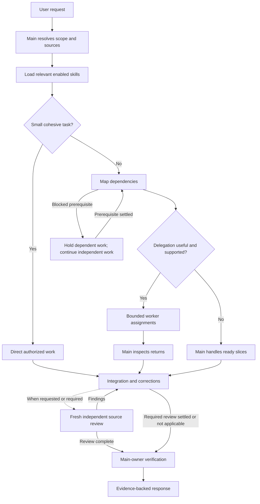
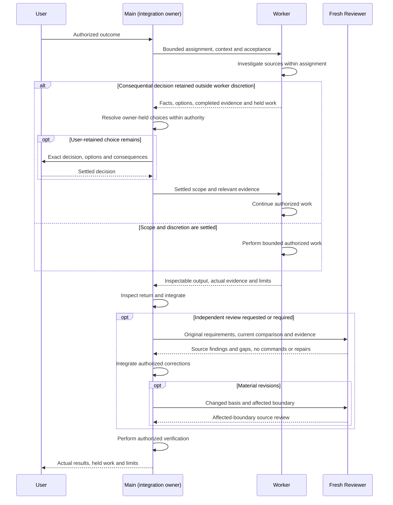

# How Agents Work in KitShift

[README](README.md) · [Skill use-case guide](SKILL-USAGE.md)

## What KitShift supplies

KitShift supplies passive skills, working preferences, harness settings and MCP definitions; omp supplies the implemented agent runtime. [How installation works](README.md#how-it-works) explains the explicit copy/update operation: using agents is separate from installation, and editing a checkout does not synchronize an installed setup. The [omp compatibility record](harnesses/omp/COMPATIBILITY.md) describes scoped integration evidence, not a guarantee for your current runtime. This guide explains the existing contracts for repository readers; it is not another agent policy or runtime registry.

## Terms and responsibilities

The [passive skill contract](skills/agent-guidance/references/skill-contract.md#consumerpermission-binding) separates the concepts:

- **Main agent / integration owner:** the caller coordinating the requested result, inspecting returned work and retaining authorization decisions and final evidence acceptance, as described in the [implementation brief](skills/workflow-delivery/references/implementation-brief.md).
- **Delegated worker:** an agent receiving a bounded assignment through a host-supported interface, with the capabilities and limits actually available in that host.
- **Assignment:** the current outcome, scope, permitted actions, discretion and expected return—not a reusable agent identity.
- **Skill:** passive reusable knowledge or procedure, loaded when relevant, enabled and authorized. Naming it does not prove its body was read or grant tools; see [invocation and loading](skills/agent-guidance/references/skill-contract.md#real-invocation-and-loading).
- **Native role / capability:** the tools and interaction policy the host actually implements. Markdown does not register roles or enforce isolation.
- **Model selector:** a configured model choice for a native purpose, not an assignment responsibility or worker identity; see [model selections](README.md#model-selections).

The [responsibility and return contract](skills/workflow-delivery/references/implementation-brief.md#responsibility-and-return) distinguishes these assignments:

| Responsibility | Expected return | What the return does not authorize or establish |
|---|---|---|
| Investigation | Findings tied to inspected sources, separating facts, inference and missing evidence | A fix, or proof that a proposed implementation works |
| Implementation | Bounded change, affected consumers, acceptance coverage, inspectable check evidence and unrun checks | Independent review or final acceptance |
| Consultation | Supported recommendation, alternatives, tradeoffs, assumptions and retained decisions | Design approval or permission to implement |
| Review | Findings against the supplied comparison, requirements and standards, with evidence and coverage gaps | Repairs, scope changes or runtime proof from source inspection alone |

These are not four registered agents, automatic stages or model identities. One main agent can perform the authorized work directly; not every task needs every responsibility. The [implementation brief](skills/workflow-delivery/references/implementation-brief.md) owns assignment details rather than this explanatory guide.

## From request to accepted result



*Intended decision flow, not automatic dispatch or a fixed agent pipeline. Integration accepts only ready work; held dependent work is not complete.*

The main agent first resolves the authorized outcome and source facts, then reads relevant enabled skill bodies and conditional references. An [ordinary bounded change](skills/code-implementation/SKILL.md#ordinary-change) can proceed directly. A [whole-spec task graph](skills/code-implementation/SKILL.md#whole-spec-task-graph) maps prerequisites and ready slices; delegation is optional when useful and host-supported. Neither skills nor this diagram require documentation-first delivery, TDD or independent review for every change.

The integration owner inspects returns against acceptance criteria and performs the actual authorized checks, distinguishing worker assertions, source inspection and observed behavior. [Verification ownership](skills/workflow-delivery/references/implementation-brief.md#verification) specifies which focused checks a worker may run and which integrated checks remain with the owner. [Fresh independent review](skills/code-review/references/review-brief.md#inputs-the-controller-supplies) applies when requested or required; its findings feed corrections, not automatic acceptance.

## Delegation and handoffs

Workers do not automatically inherit all caller context. The [implementation brief](skills/workflow-delivery/references/implementation-brief.md) calls for a bounded assignment containing:

- The outcome and acceptance criteria, including the relevant original approved requirements.
- Allowed actions, affected scope, exclusions and shared-write ownership.
- Actual source/context: decisive content or readable locators, current interfaces and prerequisite evidence—not just a task title.
- Settled decisions, worker discretion and consequential decisions retained by the owner or user.
- The expected return, authorized checker, concrete check/input and expected observable evidence.

For a producer/consumer dependency, provide the actual output or a readable locator in the consumer's context. Under the [dependency handoff contract](skills/workflow-delivery/references/implementation-brief.md#dependency-handoffs), the integration owner inspects that output and relevant evidence against the consumer's prerequisite contract on the current integration basis before dependent mutation. A worker's completion label alone does not make the input ready. Missing, inaccessible, stale or incompatible inputs hold only affected dependent work; independent authorized work can continue. This also applies when one agent handles every slice.

## Independent review and decisions



*Message ownership for a delegated assignment, not a requirement to delegate. Review remains conditional; user questions are limited to user-retained choices.*

The [source-inspecting review brief](skills/code-review/references/review-brief.md) keeps review read-only: source inspection, no execution, writes, network or delegation. When independent review is requested or required, a fresh permitted reviewer receives original requirements, the inspectable comparison and accessible evidence; author explanations remain claims. The reviewer examines decisive source and callers independently, reports findings and gaps, and does not repair the change or regenerate runtime evidence. The integration owner handles authorized corrections and reserved integrated checks. Material revisions need review of the affected boundary, not reuse of an obsolete verdict.

Advice is not approval. For a consequential choice outside a worker's discretion, the [decision escalation contract](skills/workflow-delivery/references/implementation-brief.md#decision-escalation) calls for the exact unresolved decision, inspected facts and uncertainty, viable options and consequences, any supported recommendation, completed work/evidence and dependent work held. The owner settles choices within its authority and asks the user only for a material user-retained decision or new authorization. Settled scope then returns to the worker; an escalation is useful progress, not completion of the deliverable.

## Practical use cases

These five examples reuse the [hypothetical workshop-booking product](SKILL-USAGE.md#example-a-community-workshop-booking-product). They are copyable requests for a project with actual source and supplied requirements, not executed KitShift scenarios. None authorizes commits, pushes, installation, publication or remote mutations; skill names do not enforce permissions or prove successful runtime behavior.

### 1. Small spelling correction

Use [code-implementation](skills/code-implementation/SKILL.md#ordinary-change):

```text
Use code-implementation to fix the spelling of the booking CLI label
identified in this request. Preserve its API and all unrelated behavior.
Exercise the changed CLI output and report the actual result and limits.
Do not commit or publish.
```

**Who does what:** main inspects the label and its consumers, makes the bounded correction directly and exercises the CLI. No obligatory worker, documentation-first or review pipeline.

**Expected evidence:** the changed source location, the actual CLI input/output and any unrun checks; no claim that an example here already passed.

### 2. Dependent multi-part feature

Use [code-implementation](skills/code-implementation/SKILL.md#whole-spec-task-graph):

```text
Use code-implementation to implement the supplied, already approved
booking-conflict spec covering availability and reservation rejection.
Map prerequisites and acceptance criteria. Delegate only where useful
and supported, with complete bounded contracts. Before dependent mutation,
inspect the availability producer's interface/output against the rejection
consumer's needs. Own integrated acceptance for the whole supplied spec.
Do not commit, publish or change remote state.
```

**Who does what:** main maps the real dependency graph rather than inventing paths or APIs. Optional workers receive original requirements, scope, discretion, actual context, expected returns and checker boundaries. Main inspects the producer output before starting its consumer, even if main implements both.

**Expected evidence:** readable producer output/interface and prerequisite assessment, criterion-level coverage, actual integrated availability/rejection checks and unrun limits. An incompatible prerequisite holds its consumer, not independent work. The [handoff contract](skills/workflow-delivery/references/implementation-brief.md#dependency-handoffs) owns readiness.

### 3. Independent read-only review

Use [code-review](skills/code-review/SKILL.md):

```text
Use code-review for an independent read-only review of the supplied
original/current comparison against the supplied booking spec.
Inspect decisive source and callers independently of the author's claims.
Return findings and coverage gaps only. Do not execute commands, edit,
repair, access the network or delegate.
```

**Who does what:** main supplies the original requirements, inspectable comparison and accessible check evidence to a fresh permitted reviewer. The reviewer follows the [source-only brief](skills/code-review/references/review-brief.md), not the author's requested verdict. Main owns any later separately authorized repair and runtime verification.

**Expected evidence:** exact source locations, requirement-linked findings, source-covered verdicts and missing proof. Reading existing evidence is not rerunning checks; source review is not observed runtime acceptance.

### 4. Architecture consultation

Use [code-architecture](skills/code-architecture/SKILL.md):

```text
Use code-architecture to compare request-owned availability-cache designs
for the workshop-booking flow using the supplied requirements and source.
Return viable alternatives, tradeoffs, assumptions and a recommendation
only. Do not edit, execute commands or register roles. Leave the design
decision with me; this request does not authorize implementation.
```

**Who does what:** main or a bounded consultant inspects the real interface, lifecycle and callers, then compares designs within the request. The user retains the stated design decision.

**Expected evidence:** source-grounded alternatives, consequences and a recommendation with unresolved assumptions. Under the [consultation contract](skills/workflow-delivery/references/implementation-brief.md#responsibility-and-return), advice neither approves the design nor creates a new role.

### 5. Unsettled policy plus independent work

Use [workflow-brainstorming](skills/workflow-brainstorming/SKILL.md#approval-boundary) for the unresolved policy and [code-implementation](skills/code-implementation/SKILL.md#ordinary-change) for the settled change:

```text
Investigate booking cancellation/refund ordering using
workflow-brainstorming, but leave the failure policy with me.
Report the exact unresolved choice, inspected facts, viable options and
consequences; do not mutate the policy-dependent flow.
Separately, use code-implementation to make the settled booking CLI label
correction supplied in this request, preserving its API. Exercise that
CLI path and report its actual result. Do not commit or publish.
```

**Who does what:** main or a bounded investigator resolves source facts and returns the retained policy choice without silently selecting it. Main completes and verifies only the independent authorized label change; policy-dependent mutation waits for the user's decision.

**Expected evidence:** inspected ordering/failure paths, uncertainty, options, the exact held work and the label correction's actual CLI result. The [escalation contract](skills/workflow-delivery/references/implementation-brief.md#decision-escalation) separates useful partial returns from completion of dependent work.

## Boundaries and evidence

Actual host-supported roles and tools determine capability. The [passive permission contract](skills/agent-guidance/references/skill-contract.md#consumerpermission-binding) does not turn Markdown instructions, read-only labels or tool lists into role registration or enforced confinement. [MCP definitions](README.md#mcp-integrations) are not proof of connectivity, authentication or successful actions. [Configured model selectors](README.md#model-selections) are personal selections, not performance rankings or fixed worker identities.

Read [safety and privacy](README.md#safety-and-privacy) before relying on configured approvals or external tools. The [historical installed-responsibility assessment](harnesses/omp/COMPATIBILITY.md#observed-installed-responsibility-acceptance) records its tested snapshots and limitations; it is not current compatibility acceptance or a universal behavioral guarantee. This guide reports no new consuming-agent experiments or runtime behavior tests.
