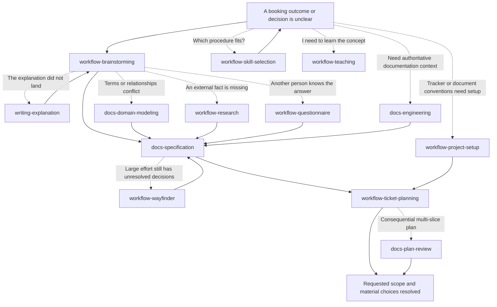
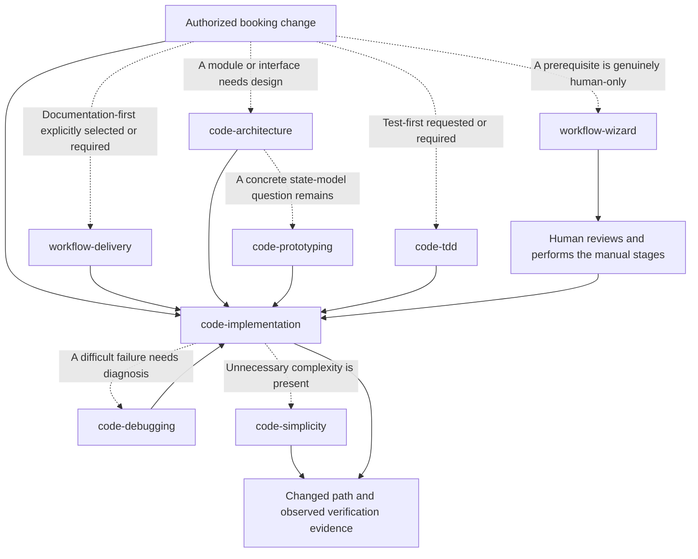
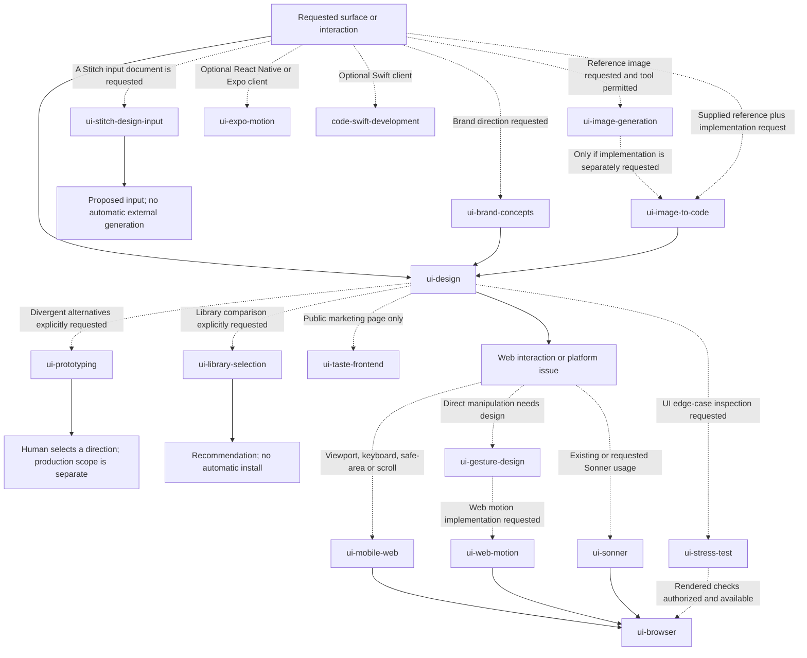
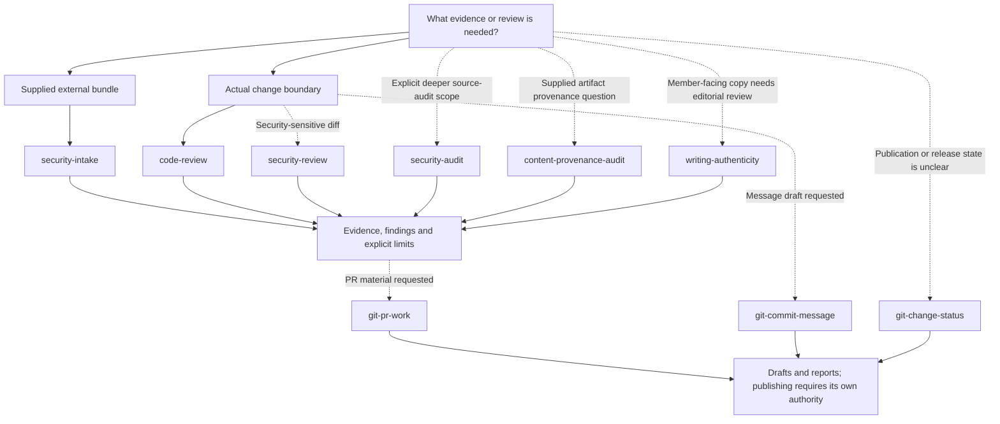
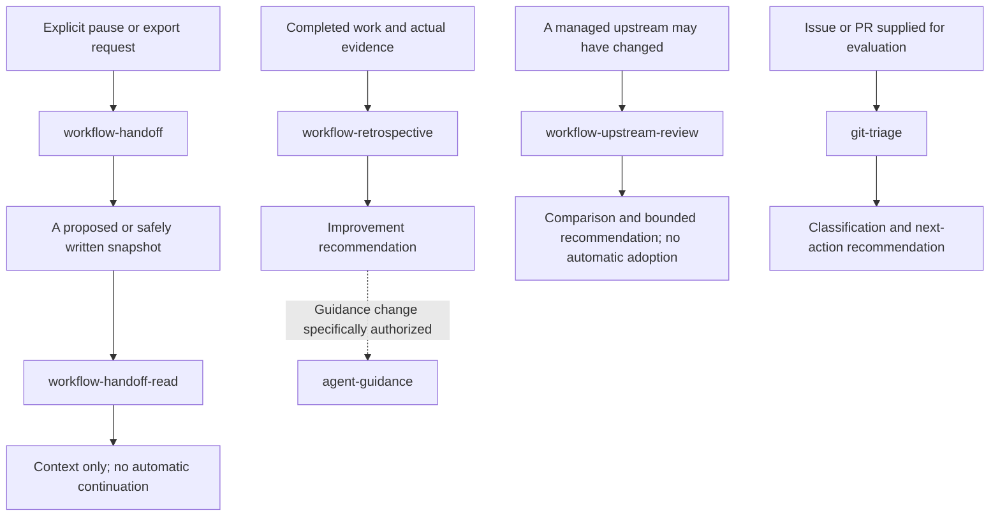

# KitShift Skill Use Cases

A practical guide to all **52 skills**: when to choose one, what to ask, and what result to expect. This is a full-coverage example, **not a command to run every skill**.

## How to use this guide

- **U — user-invoked only:** explicitly request the skill. Its metadata requests no implicit model invocation; the selected host must support that field to enforce exposure. The explicit-request boundary still applies where it does not.
- **M — model-invokable:** the assistant may select it when relevant and supported by the host; you can also request it explicitly. Its action-specific scope still applies. For example, a model-invokable security audit still needs an explicit, bounded audit request.
- The prompt column gives example arguments for that row's skill. You can also say “Use `<skill-name>` to …” in ordinary language.

Ordinary-language requests work without a particular slash-command interface:

```text
Use workflow-brainstorming to grill me about the booking cancellation rules.
Use code-implementation to implement the approved availability slice; do not commit or publish.
```

Examples describe **intended results, not checks already performed**. A skill does not create missing tools, grant permissions, or guarantee model compliance. Read-only requests remain read-only. Image generation, installation, tracker publication, commits, pushes, and deployment need their own applicable authority.

The diagrams show decision and information flow, not automatic dispatch. Dashed arrows are conditional additions. Each skill appears in one use-case table; its link opens the full procedure. [Sources and license boundaries](README.md#documentation-sources-and-licenses) remain separate from this usage guide.

## Example: a community-workshop booking product

**Hypothetical scenario—not a KitShift application:** workshop members reserve shared equipment; staff manage availability and returns. The project may have a public marketing website, a staff dashboard, and mobile web. React Native/Expo and Swift are **alternative, optional client projects**, not requirements.

Suppose the work spans discovery, implementation, reviews, a pause, and later maintenance. Different moments justify different skills:

1. [Understand and plan](#1-understand-and-plan) — resolve the right questions and define acceptance.
2. [Design and build](#2-design-and-build) — implement only the authorized scope.
3. [Choose the UI/platform branch](#3-choose-the-uiplatform-branch) — use the actual surface and stack.
4. [Review and prepare delivery](#4-review-and-prepare-delivery) — gather evidence and draft publication material.
5. [Pause, learn, and maintain](#5-pause-learn-and-maintain) — preserve context and improve the next task.

For a small, clear bug, skip the large-project planning and design branches. For backend-only work, skip the UI branch entirely.

## 1. Understand and plan

**Situation:** “Members need reservations, but we disagree about holds, cancellations, and staff overrides.” Choose the branch that resolves the actual uncertainty; setup and documentation adoption are not prerequisites for every task.



| Skill | Mode | Example prompt | Useful result and boundary |
|---|---|---|---|
| [workflow-skill-selection](skills/workflow-skill-selection/SKILL.md) | U | “Which available skill fits an uncertain booking policy?” | A recommendation with reasons and alternatives; it does not dispatch the selected workflow. |
| [workflow-teaching](skills/workflow-teaching/SKILL.md) | U | “Teach me transaction isolation using reservation conflicts; keep this lesson in chat.” | A bounded explanation and practice. Persistent learning records require an authorized teaching workspace. |
| [writing-explanation](skills/writing-explanation/SKILL.md) | U | “Re-explain your previous point about a hold versus a confirmed reservation.” | A clearer explanation of that point, not a new policy decision or implementation. |
| [workflow-questionnaire](skills/workflow-questionnaire/SKILL.md) | U | “Draft questions for the workshop manager about cancellation fees; don't send them.” | A recipient-answerable questionnaire; it does not invent the manager's answers or contact them. |
| [workflow-research](skills/workflow-research/SKILL.md) | M | “Research booking-time-zone handling using primary sources; return cited findings here.” | Findings with version applicability and unknowns, not unsupported recommendations or automatic file writes. |
| [workflow-brainstorming](skills/workflow-brainstorming/SKILL.md) | M | “Grill me about simultaneous reservations, cancellations, and staff overrides.” | Decisions and unresolved trade-offs. This is our merged Matt `grill-me`/`grilling` capability; it skips settled questions. |
| [docs-domain-modeling](skills/docs-domain-modeling/SKILL.md) | M | “Resolve the meanings of hold, reservation, loan, and return; propose glossary wording.” | Definitions, relationships, and justified ADR proposals; no unauthorized document or code changes. |
| [workflow-project-setup](skills/workflow-project-setup/SKILL.md) | U | “Record our existing tracker, triage labels, and document locations; don't create remote labels.” | A project-specific workflow contract, preserving incumbent owners; not installation or tracker publication. |
| [docs-engineering](skills/docs-engineering/SKILL.md) | M | “Find the authoritative booking requirements and missing documentation; status only.” | Evidence-backed document context and next steps. Status does not adopt or migrate a documentation tree. |
| [docs-specification](skills/docs-specification/SKILL.md) | U | “Synthesize our settled booking discussion into a spec; draft it here without publishing.” | Observable acceptance, errors, exclusions, and evidence needs—not another interview or implementation approval. |
| [workflow-wayfinder](skills/workflow-wayfinder/SKILL.md) | U | “Map unresolved decisions for multi-workshop booking; propose the map without tracker writes.” | A destination, sharp questions, unresolved fog, and a decision frontier; not premature implementation tickets. |
| [workflow-ticket-planning](skills/workflow-ticket-planning/SKILL.md) | U | “Split the settled booking spec into complete end-to-end tickets with genuine blockers; draft only.” | An acyclic dependency graph with criterion coverage; no automatic ticket publication. |
| [docs-plan-review](skills/docs-plan-review/SKILL.md) | M | “Review this multi-slice plan for acceptance coverage, integration seams, and missing prerequisites.” | Read-only coverage findings and gaps. Review does not implement or approve the plan. |

**Choose the distinction:** an interview resolves intent; research resolves external facts; a questionnaire collects another person's knowledge; a specification synthesizes settled context; ticket planning slices executable work; wayfinding maps unresolved decisions.

## 2. Design and build

**Situation:** the approved slice is “show availability and reject conflicting reservations.” Ordinary implementation stays lightweight. Documentation-first delivery is a separate opt-in or established project requirement, not a reward for having a large spec.



| Skill | Mode | Example prompt | Useful result and boundary |
|---|---|---|---|
| [code-architecture](skills/code-architecture/SKILL.md) | M | “Compare interfaces for availability checks so booking rules do not leak across callers; propose only.” | A justified module boundary, alternatives, test surface, and migration risks—not speculative abstractions. |
| [code-prototyping](skills/code-prototyping/SKILL.md) | M | “Build a disposable, in-memory model to test whether expiring holds can oversubscribe a tool.” | A hypothesis, runnable experiment, and observed limits. It is not production code or a real database integration. |
| [code-implementation](skills/code-implementation/SKILL.md) | U | “Implement the approved availability slice and exercise the changed path; no commits or remote actions.” | A complete bounded change with evidence. Whole-spec requests use genuine dependency frontiers, not a forced subagent topology. |
| [code-tdd](skills/code-tdd/SKILL.md) | M | “Use test-first development for simultaneous booking conflicts at the existing service seam.” | A meaningful failing test, minimal correction, and refactor cycle—not tests of incidental internal calls. |
| [code-simplicity](skills/code-simplicity/SKILL.md) | M | “Review this booking diff for unnecessary abstractions; recommendations only.” | Consequence-backed simplifications without dropping acceptance or safety checks. One-shot review does not activate an ongoing mode. |
| [code-debugging](skills/code-debugging/SKILL.md) | M | “The reported conflict bug is established; investigate its cause and fix the authorized path.” | Discriminating evidence, causal correction, and remediation proof—not another run merely to confirm the report. |
| [workflow-delivery](skills/workflow-delivery/SKILL.md) | M | “Use documentation-first delivery for this approved booking boundary; reuse existing owners and prove each criterion.” | The explicitly selected baseline, reviewed plan, implementation, and reconciled evidence; not a universal requirement for other work. |
| [workflow-wizard](skills/workflow-wizard/SKILL.md) | M | “Create a reviewed Bash wizard for the operator's manual provider-dashboard setup; do not run it.” | A task-specific script with consent, interruption, and secret-handling safeguards. Not automatic credential discovery or infrastructure execution. |

## 3. Choose the UI/platform branch

**Situation:** members need a public site and booking form; staff need a task-focused calendar. Start with the actual product surface. Concept images, Stitch inputs, and UI alternatives are optional aids—not required inputs to normal frontend work.



The image-to-code edge requires a separate implementation request; producing an image does not authorize building from it. Browser checks need an available permitted browser tool. Desktop resizing is not real-phone or native-device proof.

| Skill | Mode | Example prompt | Useful result and boundary |
|---|---|---|---|
| [ui-brand-concepts](skills/ui-brand-concepts/SKILL.md) | M | “Propose workshop brand-board directions from the supplied identity; no image generation.” | Brief-led visual proposals, not production assets, trademark clearance, or an implied image-tool call. |
| [ui-design](skills/ui-design/SKILL.md) | M | “Review the staff booking calendar for scanability and task completion; do not edit.” | Findings tied to the actual dashboard. This is the primary general UI owner; review is not redesign authorization. |
| [ui-stitch-design-input](skills/ui-stitch-design-input/SKILL.md) | M | “Draft a proposed Stitch design input from observed tokens; return it here and mark unknowns.” | A proposed, noncanonical design input. Local drafting does not require or invoke the external service. |
| [ui-image-generation](skills/ui-image-generation/SKILL.md) | M | “Generate a reference image for the mobile booking flow using these supplied labels; images only.” | Requested images, if a permitted tool is available; otherwise a precise prerequisite limit. No frontend implementation. |
| [ui-image-to-code](skills/ui-image-to-code/SKILL.md) | M | “Implement this supplied booking screenshot using our existing components and real booking actions.” | An authorized frontend implementation and checks; a screenshot does not establish hidden behavior or backend functionality. |
| [ui-prototyping](skills/ui-prototyping/SKILL.md) | U | “Build three isolated booking-calendar variants with a comparison picker; don't promote any to production.” | Meaningfully different, inspectable alternatives. Selecting and shipping a variant remains a separate scope decision. |
| [ui-library-selection](skills/ui-library-selection/SKILL.md) | U | “Compare our incumbent notifications with Sonner for booking feedback; recommend only.” | Compatibility and trade-off analysis, not installation, integration, or an automatic stack change. |
| [ui-taste-frontend](skills/ui-taste-frontend/SKILL.md) | M | “Refine the public landing page into a distinctive workshop marketing experience; preserve factual copy.” | Selective marketing-page guidance or authorized changes. Not the staff dashboard, data tables, or native UI. |
| [ui-mobile-web](skills/ui-mobile-web/SKILL.md) | M | “Diagnose the Reserve button being covered by the phone keyboard; propose a scoped mobile-web fix.” | Platform-specific evidence and a remedy, with untested device behavior disclosed. Not React Native development. |
| [ui-gesture-design](skills/ui-gesture-design/SKILL.md) | M | “Design swipe-to-reveal booking actions with cancellation, reversal, and keyboard alternatives.” | A gesture contract including accessible alternatives; implementation is not implied by a design request. |
| [ui-web-motion](skills/ui-web-motion/SKILL.md) | M | “Implement a restrained, interruptible booking-details transition with reduced-motion support.” | Purposeful motion using the actual web stack. Audit or plan requests remain proposals; Expo is a different branch. |
| [ui-sonner](skills/ui-sonner/SKILL.md) | M | “Our existing Sonner success toast appears twice; diagnose it without edits.” | Version- and lifecycle-aware findings, not installation of Sonner or a generic toast wrapper. |
| [ui-stress-test](skills/ui-stress-test/SKILL.md) | M | “Propose booking-list edge cases: long tool names, empty results, missing optional descriptions, and large lists.” | Contract-aware cases with unknown limits named. Inspection-only requests create no fixtures or harnesses. |
| [ui-browser](skills/ui-browser/SKILL.md) | M | “Inspect the booking page in an isolated browser at narrow and wide widths; report layout and console evidence.” | Observations from an actual permitted session, or an availability limit—not claims based only on source inspection. |
| [ui-expo-motion](skills/ui-expo-motion/SKILL.md) | M | “Review drag/dismiss behavior in the optional Expo booking sheet, including interruption and reduced motion.” | React Native/Expo-specific proposals grounded in its actual SDK and dependencies; not web animation. |
| [code-swift-development](skills/code-swift-development/SKILL.md) | M | “Review the optional Swift client's reservation-cache race against its actual concurrency settings.” | Swift/toolchain-specific diagnosis and a safe correction proposal; not a reason to add a native client. |

## 4. Review and prepare delivery

**Situation:** the slice is ready for review, or an artifact/dependency raises a specific question. These are independent review scopes, not nine mandatory release gates. Intake belongs before the relevant adoption decision, not automatically after coding.



| Skill | Mode | Example prompt | Useful result and boundary |
|---|---|---|---|
| [code-review](skills/code-review/SKILL.md) | M | “Review the booking diff against the approved spec and repository standards; no edits or test execution.” | Separate correctness/standards and spec verdicts, concrete findings, and coverage limits. |
| [security-intake](skills/security-intake/SKILL.md) | M | “Inspect this supplied calendar-plugin source and revision for actual authority; don't fetch, install, or run it.” | A source-backed intake verdict and conditions. It neither certifies safety nor approves adoption. |
| [security-review](skills/security-review/SKILL.md) | M | “Review this base/head diff changing who may cancel reservations; keep the review source-only.” | Findings tied to the changed boundary and surrounding controls, not an unrequested whole-codebase audit. |
| [security-audit](skills/security-audit/SKILL.md) | M | “Perform a bounded source-only audit of staff reservation-change authorization and its entry paths.” | Deeper boundary/coverage analysis with challenged findings and unknowns; not a live penetration test or execution permission. |
| [content-provenance-audit](skills/content-provenance-audit/SKILL.md) | M | “Inspect this supplied booking-policy PDF for observable provenance evidence; preserve it.” | Method-qualified observations and uninspected layers. No AI/human authorship, originality, or legal-clearance verdict. |
| [writing-authenticity](skills/writing-authenticity/SKILL.md) | M | “Review the return reminder for clarity and workshop voice; suggest targeted edits without rewriting.” | Concrete editorial suggestions preserving meaning and facts—not authorship detection or fabricated personal detail. |
| [git-change-status](skills/git-change-status/SKILL.md) | M | “Report whether these booking changes are local, pushed, merged, or released; don't fetch or mutate.” | Separate evidence-qualified states, including unknown remote/deployment status. A tag alone does not prove deployment. |
| [git-commit-message](skills/git-commit-message/SKILL.md) | M | “Suggest a subject for the staged booking-conflict fix using recent repository style.” | Commit-message text based on the applicable diff. It never stages, commits, or pushes. |
| [git-pr-work](skills/git-pr-work/SKILL.md) | M | “Draft the booking PR from the actual change and repository template; include observed checks and merge risk.” | Unpublished PR material with evidence and limits. Branch creation, commits, pushes, and remote PR actions are not implied. |

For **authorized remote GitHub operations**, use the available GitHub MCP capabilities first. Drafting PR text or recommending a label is not publication authorization. Local Git inspection remains a different operation; do not infer fresh remote state from stale local refs.

## 5. Pause, learn, and maintain

**Situation:** the team pauses, a successor reads the handoff, or later evidence suggests a small improvement. Reading context, resuming execution, and changing guidance are distinct requests.



| Skill | Mode | Example prompt | Useful result and boundary |
|---|---|---|---|
| [workflow-handoff](skills/workflow-handoff/SKILL.md) | M | “Pause and export a portable handoff to the next unused snapshot path; omit credentials.” | A non-overwriting snapshot with actual progress, evidence, remaining work, and authorization limits; a proposal only under read-only permissions. |
| [workflow-handoff-read](skills/workflow-handoff-read/SKILL.md) | M | “Read the selected handoff and summarize it; don't inspect its cited files or continue the tasks.” | Snapshot-attributed context only. It is deliberately not a resume/implementation workflow. |
| [workflow-retrospective](skills/workflow-retrospective/SKILL.md) | M | “Retrospect on the completed booking slice using its real review and check results; recommend only.” | Evidence-backed lessons and small owner-specific improvements. One incident is not a proven recurring pattern. |
| [workflow-upstream-review](skills/workflow-upstream-review/SKILL.md) | M | “Compare relevant upstream changes for this evidenced managed integration with our local baseline; recommendations only.” | A scoped adopt/investigate/no-action/blocked recommendation with provenance limits; no installation or automatic adoption. |
| [agent-guidance](skills/agent-guidance/SKILL.md) | M | “Revise our existing booking-review guidance to clarify the observed permission confusion; preserve its source notices.” | A scoped, native-compatible guidance change with one owner. Source review does not prove future agent behavior. |
| [git-triage](skills/git-triage/SKILL.md) | M | “Triage this supplied double-booking issue; recommend a category and state without posting or labeling.” | Evidence versus claims, missing facts, duplicate candidates, and a next action. Remote mutations require a specific request. |

## Small combinations to start with

Pick the smallest matching path, not every row:

- **“Grill me before I build.”** Start with the interview in section 1; add domain modeling only when terms or relationships need work.
- **“Fix this established booking bug.”** Diagnose the cause, implement the authorized fix, and exercise its changed path; request test-first work only if that is the intended method.
- **“Improve the staff dashboard.”** Use general UI guidance and browser evidence; choose mobile, motion, toast, or stress branches only for the actual issue. Marketing Taste guidance is not the dashboard workflow.
- **“Prepare a release.”** Review the actual change and draft the requested Git material. Commit, push, release, and deployment are separate authorized actions—not skills inferred from a draft.
- **“Pause and transfer.”** Export a snapshot, then read it as context in the next session. Give a separate current instruction if you want execution to resume.

This guide demonstrates a use case for every current skill. It does not report that the hypothetical product exists, that the workflows were executed, or that all integrations are available. For exact scope, invocation metadata, source records, and notices, follow each skill link and the [README](README.md).
